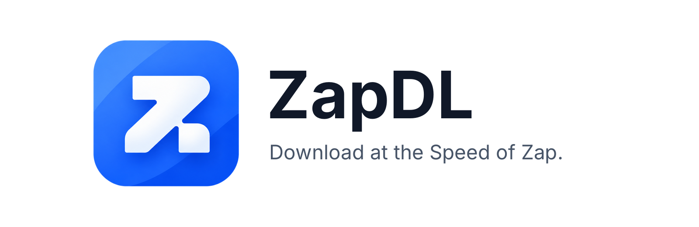

<div align="center">



### مدیر دانلود سریع و رایگان برای ویندوز، لینوکس، macOS، اندروید و iOS

[](https://github.com/ghaderi0x/ZapDL/releases/latest)
[](LICENSE)

**[⬇ دانلود](#-دانلود)** · **[امکانات](#-امکانات)** · **[آموزش](#-آموزش-استفاده)** · **[پرسش‌ها](#-پرسش‌های-متداول)** · **[برای برنامه‌نویسان](#-برای-برنامه‌نویسان)** · [English](README.md)

<br>


</div>

<div dir="rtl">

---

## ⬇ دانلود

فایل مخصوص سیستم خود را از **[آخرین نسخه](https://github.com/ghaderi0x/ZapDL/releases/latest)** بگیرید.

| سیستم | فایل | نصب |
|---|---|---|
| 🪟 **ویندوز** | `ZapDL-…-windows-x64-setup.exe` (یا `.zip` بدون نصب) | اجرا کنید؛ نیازی به دسترسی مدیر نیست. |
| 🤖 **اندروید** | `ZapDL-…-android.apk` | فایل را باز کنید و در صورت پرسش «نصب از منبع ناشناس» را مجاز کنید. |
| 🐧 **لینوکس** | `ZapDL-…-linux-x64.tar.gz` | `tar -xzf ZapDL-*.tar.gz -C ~/zapdl && ~/zapdl/zapdl` |
| 🍎 **macOS** | `ZapDL-…-macos.dmg` | به Applications بکشید؛ بار اول راست‌کلیک ← Open. |
| 📱 **iOS** | منتشر نشده | حساب توسعه‌دهنده اپل لازم است؛ از سورس بسازید. |

کاربران اندروید پس از انتشار می‌توانند از **مایکت** و **کافه‌بازار** هم نصب کنند (نسخه‌های فروشگاهی را خود فروشگاه به‌روز می‌کند).

> **وضعیت:** نسخه ۱٫۰٫۰. تست‌های خودکار موفق‌اند و نسخه ویندوز واقعاً استفاده شده است. نسخه‌های اندروید، لینوکس و macOS جدیدترند و کمتر آزموده شده‌اند؛ اگر مشکلی دیدید [گزارش دهید](https://github.com/ghaderi0x/ZapDL/issues/new/choose).

## ✨ امکانات

| | |
|---|---|
| ⚡ **سریع** | فایل را به چند بخش تقسیم می‌کند و هم‌زمان می‌گیرد (اگر سرور اجازه دهد). |
| ⏯ **توقف و ادامه** | هر وقت بخواهید متوقف کنید، برنامه را ببندید و بعداً ادامه دهید. اگر فایل روی سرور تغییر کرده باشد، خراب نمی‌شود؛ به شما خبر می‌دهد. |
| 📦 **گروه لینک‌ها** | همه بخش‌های یک بازی (`part1`، `part2`، …) را بدهید؛ به ترتیب و یکی‌یکی دانلود می‌شوند. «بخش بعدی خودکار» خودش part2 و part3 را پیدا می‌کند. |
| 🎬 **ویدیو از لینک** | یوتیوب، ردیت، تلگرام و صفحه‌های وب: لینک صفحه را بدهید و کیفیت را انتخاب کنید. |
| 🕒 **زمان‌بندی** | شروع در زمانی دیگر یا فقط در ساعت‌های مشخص (مثلاً ۲۳ تا ۶ صبح). |
| 📶 **فقط Wi-Fi** | هرگز از اینترنت موبایل استفاده نمی‌کند و با برگشتن Wi-Fi خودش ادامه می‌دهد. |
| 🌐 **پروکسی، کوکی و هدر** | برای سایت‌های فیلتر یا نیازمند کوکی ورود. از پروکسی سیستم ویندوز/macOS پیروی می‌کند. |
| 🔔 **وضعیت همه‌جا** | پیشرفت در اعلان اندروید، سرعت و تعداد در Tray ویندوز. |
| 🗑 **تشخیص فایل پاک‌شده** | اگر فایل دانلودشده را پاک کنید، ردیف آن «فایل حذف شده» می‌شود و «دانلود دوباره» دارد. |
| 🔄 **به‌روزرسانی خودکار** | از GitHub Releases بررسی، دانلود، تأیید SHA-256 و نصب می‌کند. |
| 🎨 **۴ تم × روشن/تیره** | جنگل، غروب، اقیانوس، یخچال طبیعی، رنگ دلخواه و دکمه سریع روشن/تیره. |
| 🌍 **۶ زبان** | English، فارسی، العربية، Español، 中文، Русский با چیدمان خودکار راست‌به‌چپ. |
| 🔒 **خصوصی** | بدون حساب، تبلیغ و آمارگیری. |

## 🚀 آموزش استفاده

1. **افزودن لینک:** دکمه **+** (یا `Ctrl+N`) را بزنید و لینک را بچسبانید. در کامپیوتر می‌توانید لینک یا فایل `.txt` را روی پنجره **بکشید**؛ در اندروید از هر برنامه **Share ← ZapDL** را بزنید.
2. **انتخاب** پوشه و (برای ویدیو) کیفیت، سپس **Add**.
3. **پیگیری** در فهرست. روی ردیف بزنید تا جزئیات ببینید؛ راست‌کلیک (یا منوی ⋮) برای توقف، باز کردن، کپی لینک و حذف.

**فایل چندبخشی:** در پنجره افزودن، **گروه لینک‌ها** را بزنید، هر لینک را در یک خط و به ترتیب بنویسید و در صورت نیاز *دانلود خودکار بخش‌های بعدی* را روشن کنید.

**یوتیوب در کشور شما فیلتر است؟** ZapDL به‌تنهایی فیلتر را رد نمی‌کند، اما از VPN/پروکسی شما استفاده می‌کند. اگر ابزارتان پروکسی سیستم را تنظیم می‌کند، *تنظیمات ← شبکه ← پروکسی* را روی **سیستم** بگذارید؛ وگرنه **دستی** را انتخاب و پورت HTTP آن را بنویسید (مثلاً `127.0.0.1:10809`). پورت فقط-SOCKS کار نمی‌کند. جزئیات: [docs/MEDIA_SOURCES.md](docs/MEDIA_SOURCES.md).

## ❓ پرسش‌های متداول

<details><summary><b>چند بار برنامه را باز کردم و در Task Manager چند ZapDL هست.</b></summary>
در نسخه ۱٫۰٫۰ اصلاح شد: باز کردن دوباره ZapDL پنجره در حال اجرا را جلو می‌آورد و نسخه دوم نمی‌سازد.
</details>

<details><summary><b>«در انتظار اتصال مجاز» می‌گوید.</b></summary>
یا آفلاین هستید، یا «فقط Wi-Fi» روشن است و به اینترنت موبایل وصلید. به Wi-Fi وصل شوید یا آن را در تنظیمات ← شبکه خاموش کنید.
</details>

<details><summary><b>اندروید می‌گوید به‌روزرسانی نصب نمی‌شود.</b></summary>
اندروید فقط فایلی را روی برنامه نصب می‌کند که با همان کلید امضا شده باشد. اگر نسخه فعلی از جای دیگری آمده، آن را حذف و APK رسمی را نصب کنید.
</details>

<details><summary><b>چرا یوتیوب ۱۰۸۰p ندارد؟</b></summary>
یوتیوب کیفیت بالا را جدا (ویدیو و صدا) می‌دهد و برای ادغام به ffmpeg نیاز است که همراه ZapDL نیست. فایل‌های آماده (معمولاً تا ۷۲۰p) یا فقط صدا را می‌گیرید.
</details>

<details><summary><b>FTP، تورنت یا SOCKS دارد؟</b></summary>
خیر. فقط دانلود HTTP/HTTPS و پروکسی HTTP.
</details>

## 🔐 حریم خصوصی و استفاده مجاز

- چیزی به جایی فرستاده نمی‌شود، جز سایت‌هایی که از آن‌ها دانلود می‌کنید، GitHub (بررسی به‌روزرسانی) و صفحه‌ای که لینک رسانه‌اش را می‌دهید.
- کوکی و رمز پروکسی در حافظه امن سیستم می‌مانند و فقط به همان سایت ارسال می‌شوند.
- ZapDL قفل DRM، پرداخت یا ورود را دور نمی‌زند. قوانین هر سایت و کپی‌رایت را رعایت کنید.
- ترجمه‌ها ماشینی‌اند و به بازبینی نیاز دارند؛ اصلاحات شما ارزشمند است.

---

# 🛠 برای برنامه‌نویسان

(بخش فنی کامل به انگلیسی در [README.md](README.md#-for-developers) و [docs/DEVELOPERS.md](docs/DEVELOPERS.md) است.)

**فناوری:** Flutter 3.27+ / Dart 3.6، `flutter_bloc`، `get_it`، موتور دانلود خالص Dart بر پایه `dart:io` (بدون وابستگی به Flutter و قابل تست)، ذخیره‌سازی JSON اتمی، حافظه امن سیستم برای رمزها، ARB برای ۶ زبان، سرویس Kotlin برای پس‌زمینه اندروید.

**اجرا:**

```bash
git clone https://github.com/ghaderi0x/ZapDL.git && cd ZapDL
dart tool/setup.dart     # ساخت پوشه‌های پلتفرم، مجوزها، آیکون، ترجمه‌ها
flutter test
flutter run -d windows   # یا linux / macos / دستگاه اندروید
```

**ساختار:** `lib/engine` موتور دانلود، `lib/features` رابط کاربری، `lib/media` استخراج رسانه، `lib/platform` سرویس‌های سیستم (Tray، اعلان، تک‌نمونه‌ای)، `lib/update` به‌روزرسانی از GitHub، `tool/` ابزار راه‌اندازی و انتشار.

**انتشار نسخه:** `dart tool/bump_version.dart 1.1.0` سپس commit، `git tag v1.1.0` و `git push origin main --tags`؛ GitHub Actions می‌سازد و Release را منتشر می‌کند. راهنمای کامل: [docs/GITHUB_GUIDE.md](docs/GITHUB_GUIDE.md).

## مجوز

[MIT](LICENSE)

</div>
