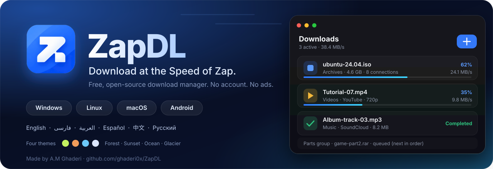
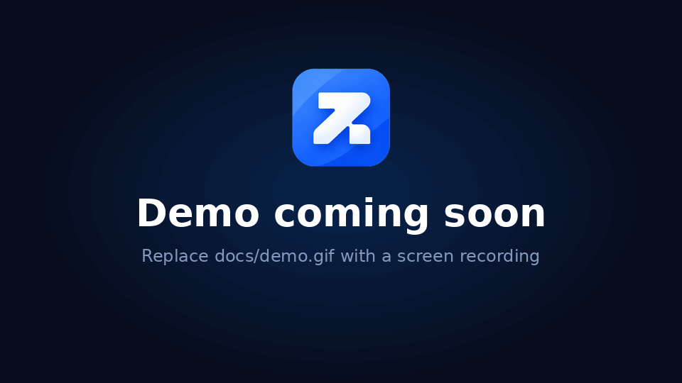

<p align="center">
  
</p>

<p align="center">
  <a href="https://github.com/ghaderi0x/ZapDL/releases/latest"></a>
  <a href="https://github.com/ghaderi0x/ZapDL/stargazers"></a>
  <a href="LICENSE"></a>
  
</p>

<p align="center">
  <a href="https://github.com/ghaderi0x/ZapDL/releases/latest"></a>
  &nbsp;
  <a href="https://github.com/ghaderi0x/ZapDL/issues/new/choose"></a>
</p>

<p align="center">
  <a href="README.md">English</a> · <b>فارسی</b>
  &nbsp;|&nbsp;
  <a href="#-دانلود">دانلود</a> ·
  <a href="#-امکانات">امکانات</a> ·
  <a href="#-شروع-کار">شروع کار</a> ·
  <a href="#-پرسشها">پرسش‌ها</a> ·
  <a href="docs/DEVELOPERS.md">راهنمای توسعه‌دهندگان</a> ·
  <a href="CHANGELOG.md">تغییرات</a>
</p>

<p align="center">
  
</p>

<div dir="rtl">

---

## مدیر دانلود جدید شما

دانلود باید ساده باشد. چه یک سند را ذخیره کنید، چه فایل حجیم بگیرید یا ویدیویی را برای بعد نگه دارید، **ZapDL** همه را در یک برنامه تمیز کنار هم می‌گذارد: رایگان، متن‌باز، بدون حساب کاربری و بدون تبلیغ.

| | |
|:--|:--|
| ⚡ **دانلود سریع‌تر**<br>فایل را (اگر سرور اجازه دهد) به چند بخش تقسیم می‌کند و هم‌زمان می‌گیرد. | ⏯️ **توقف و ادامه**<br>هر وقت خواستید متوقف کنید و بعداً ادامه دهید، حتی بعد از بستن برنامه. |
| 🎬 **ذخیره از سایت‌ها**<br>لینک را بچسبانید و کیفیت دلخواه را انتخاب کنید. | 🗂️ **مرتب و منظم**<br>دانلودها در یک پوشه و در دسته‌های روشن مرتب می‌شوند. |
| 🌍 **شش زبان**<br>فارسی، English، العربية، Español، 中文 و Русский با چیدمان راست‌به‌چپ. | 🔐 **خصوصی**<br>بدون حساب، تبلیغ، ردیابی و آمارگیری. |

## ✨ امکانات

### ⚡ دانلودی که متوقف نمی‌شود
- دانلود با چند اتصال هم‌زمان (وقتی سرور پشتیبانی کند).
- توقف و ادامه در هر لحظه.
- دانلودهای نیمه‌کاره بعد از راه‌اندازی دوباره ادامه پیدا می‌کنند.
- اگر فایل روی سرور تغییر کرده باشد، به‌جای ذخیره فایل خراب به شما خبر می‌دهد.

### 🌍 ذخیره از سایت‌های محبوب
لینک را از این سرویس‌ها بچسبانید:

<p align="center">
  <b>YouTube</b> &nbsp;·&nbsp; <b>TikTok</b> &nbsp;·&nbsp; <b>Instagram</b> &nbsp;·&nbsp; <b>X / Twitter</b> &nbsp;·&nbsp; <b>Telegram</b> &nbsp;·&nbsp; <b>Reddit</b> &nbsp;·&nbsp; <b>SoundCloud</b>
</p>

لینک مستقیم هر فایل (HTTP یا HTTPS) هم کار می‌کند.

<sub>لینک‌های پشتیبانی‌شده و کیفیت‌های موجود به سایت مبدأ بستگی دارد و همه لینک‌ها قابل دانلود نیستند. اسپاتیفای پشتیبانی نمی‌شود، چون صدای آن رمزگذاری شده است.</sub>

### 🧩 فایل‌های چندبخشی
بازی‌ها و آرشیوهای بزرگ اغلب چند بخش‌اند. لینک بخش‌ها را به‌صورت یک **گروه** بدهید تا یکی‌یکی و به ترتیب دانلود شوند. گزینه **دانلود خودکار بخش‌های بعدی** را روشن کنید تا ZapDL خودش بخش شماره‌دار بعدی را پیدا کند.

### 🗂️ جایی برای هر دانلود
همه‌چیز در `Downloads/ZapFiles` ذخیره و در این دسته‌ها مرتب می‌شود:

<p align="center">
  <code>ویدیو</code> · <code>موسیقی</code> · <code>تصویر</code> · <code>سند</code> · <code>فشرده</code> · <code>برنامه</code>
</p>

روی نام فایل تمام‌شده بزنید تا باز شود. اگر فایلی را از دیسک پاک کنید، فهرست آن را «حذف‌شده» نشان می‌دهد و اجازه می‌دهد دوباره دانلودش کنید.

### 🕒 هر وقت بخواهید
- **زمان‌بندی** برای ساعت دلخواه یا فقط در ساعت‌های مشخص.
- حالت **فقط Wi-Fi** از اینترنت موبایل شما محافظت می‌کند.
- پیشرفت را در اعلان اندروید یا Tray ویندوز ببینید.

### 🎨 ظاهری که مال شماست
<p align="center">
  
  
  
  
</p>

- چهار تم (جنگل، غروب، اقیانوس، یخچال)، هرکدام با حالت روشن و تیره، یا رنگ تاکید دلخواه خودتان.
- شش زبان با پشتیبانی راست‌به‌چپ برای فارسی و عربی.
- سازگار با گوشی، تبلت و کامپیوتر.

### 🔐 خصوصی
- بدون حساب کاربری، تبلیغ و ردیابی.
- کوکی و رمز پروکسی در حافظه امن سیستم می‌مانند.
- متن‌باز با مجوز MIT.

ZapDL فقط به سایت‌هایی که از آن‌ها دانلود می‌کنید و GitHub (برای بررسی به‌روزرسانی) وصل می‌شود. بخش [پرسش‌ها](#-پرسشها) را ببینید.

---

## ⬇ دانلود

آخرین نسخه را از **[صفحه Releases](https://github.com/ghaderi0x/ZapDL/releases/latest)** بگیرید.

| دستگاه | فایل | نصب |
|:--|:--|:--|
| 🪟 **ویندوز** | `ZapDL-…-windows-x64-setup.exe` | نصب‌کننده را اجرا کنید. نیازی به دسترسی مدیر نیست. نسخه قابل‌حمل می‌خواهید؟ فایل `.zip` را باز کنید و `zapdl.exe` را اجرا کنید. |
| 🤖 **اندروید** | `ZapDL-…-android.apk` | فایل را باز کنید. اگر اندروید پرسید، «نصب از منبع ناشناس» را برای مرورگر یا مدیر فایل مجاز کنید. |
| 🐧 **اوبونتو، دبیان، مینت** | `ZapDL-…-linux-amd64.deb` | `sudo apt install ./ZapDL-*-linux-amd64.deb` |
| 🐧 **سایر توزیع‌های لینوکس** | `ZapDL-…-linux-x64.tar.gz` | در یک پوشه باز کنید و فایل `zapdl` را اجرا کنید. |
| 🍎 **macOS** | `ZapDL-…-macos.dmg` | ZapDL را به Applications بکشید. بار اول روی آن راست‌کلیک و **Open** را بزنید. |

> **خوب است بدانید**
> - ZapDL تازه است (نسخه ۱٫۰). ویندوز بیشتر از همه آزموده شده؛ اندروید، لینوکس و macOS کمتر. اگر مشکلی دیدید [گزارش دهید](https://github.com/ghaderi0x/ZapDL/issues/new/choose).
> - برنامه هنوز امضای دیجیتال ندارد؛ ویندوز یا macOS ممکن است هشدار «ناشر ناشناس» بدهند و این طبیعی است.
> - ZapDL از GitHub نسخه جدید را بررسی می‌کند و می‌تواند خودش را به‌روز کند. با فایل `SHA256SUMS.txt` در صفحه انتشار می‌توانید فایل دانلودشده را راستی‌آزمایی کنید.

---

## 🚀 شروع کار

۱. **افزودن لینک.** دکمه **+** (یا <kbd>Ctrl</kbd>+<kbd>N</kbd>؛ در macOS <kbd>Cmd</kbd>+<kbd>N</kbd>) را بزنید و لینک را بچسبانید. در کامپیوتر می‌توانید لینک یا فایل `.txt` پر از لینک را روی پنجره بکشید. در اندروید از هر برنامه **Share ← ZapDL** را بزنید.

۲. **انتخاب.** پوشه مقصد و (برای رسانه) کیفیت را انتخاب کنید.

۳. **زدن Add** و دیدن پیشرفت در فهرست دانلودها.

۴. **مدیریت.** روی ردیف بزنید تا جزئیات را ببینید. با راست‌کلیک یا منوی ⋮ می‌توانید متوقف کنید، فایل را باز کنید، لینک را کپی یا حذف کنید.

**چند بخش از یک فایل دارید؟** در پنجره افزودن **گروه لینک‌ها** را بزنید، هر لینک را در یک خط و به ترتیب بنویسید و در صورت نیاز **دانلود خودکار بخش‌های بعدی** را روشن کنید.

---

## ❓ پرسش‌ها

<details><summary><b>سایتی در کشور من فیلتر است. چه کنم؟</b></summary>

به این ترتیب امتحان کنید:

1. **تنظیمات ← دسترسی به سایت‌های فیلترشده بدون VPN.** از DNS رمزگذاری‌شده استفاده می‌کند و شروع هر اتصال امن را تکه‌تکه می‌فرستد که از بعضی فیلترها رد می‌شود. این قابلیت آزمایشی است، VPN نیست و روی همه اپراتورها کار نمی‌کند. وقتی سایت با آدرس IP مسدود باشد، که برای تلگرام رایج است، کمکی نمی‌کند.
2. **از VPN یا پروکسی خودتان استفاده کنید.** اگر VPN پروکسی سیستم را تنظیم می‌کند، *تنظیمات ← شبکه ← پروکسی* را روی **سیستم** بگذارید. وگرنه **دستی** را انتخاب و پورت HTTP آن را بنویسید (مثلاً `127.0.0.1:10809`). پورت فقط-SOCKS کار نمی‌کند.
</details>

<details><summary><b>چرا اسپاتیفای پشتیبانی نمی‌شود؟</b></summary>
صدای اسپاتیفای رمزگذاری شده و ZapDL نمی‌تواند آن را ذخیره کند. ساندکلود و یوتیوب هرجا منبع اجازه دهد کار می‌کنند.
</details>

<details><summary><b>چرا در یوتیوب ۱۰۸۰p نیست؟</b></summary>
یوتیوب کیفیت بالا را در دو فایل جدا (ویدیو و صدا) می‌دهد که برای ادغام به ابزاری مثل ffmpeg نیاز است و همراه ZapDL نیست. پس فایل‌های آماده (معمولاً تا ۷۲۰p) یا فقط صدا را می‌گیرید. در کامپیوتر اگر <a href="https://github.com/yt-dlp/yt-dlp">yt-dlp</a> نصب کنید، ZapDL اول از آن استفاده می‌کند و ممکن است گزینه‌های بیشتری بدهد.
</details>

<details><summary><b>«در انتظار اتصال مجاز» می‌گوید.</b></summary>
آفلاین هستید، یا «فقط Wi-Fi» روشن است و از اینترنت موبایل استفاده می‌کنید. به Wi-Fi وصل شوید یا آن را در تنظیمات ← شبکه خاموش کنید.
</details>

<details><summary><b>اندروید می‌گوید به‌روزرسانی نصب نمی‌شود.</b></summary>
اندروید فقط فایلی را روی برنامه نصب می‌کند که با همان کلید امضا شده باشد. اگر نسخه فعلی از جای دیگری آمده، یک بار آن را حذف و APK صفحه Releases را نصب کنید.
</details>

<details><summary><b>تورنت، FTP یا پروکسی SOCKS دارد؟</b></summary>
فعلاً نه. ZapDL با HTTP و HTTPS دانلود می‌کند و با پروکسی HTTP کار می‌کند.
</details>

<details><summary><b>امن است؟ چه چیزی ارسال می‌کند؟</b></summary>
فقط با سایت‌هایی که از آن‌ها دانلود می‌کنید، GitHub (برای بررسی به‌روزرسانی) و صفحه لینک رسانه‌ای که می‌چسبانید ارتباط می‌گیرد. کوکی و رمز پروکسی در حافظه امن سیستم می‌مانند. حساب کاربری، تبلیغ و آمارگیری وجود ندارد. ZapDL پرداخت، ورود یا رمزگذاری را دور نمی‌زند. لطفاً قوانین هر سایت و قانون کپی‌رایت کشورتان را رعایت کنید.
</details>

---

## 🛠 ساخت از روی سورس

به [Flutter SDK](https://docs.flutter.dev/get-started/install) نسخه ۳٫۲۷ یا بالاتر نیاز دارید.

</div>

```bash
git clone https://github.com/ghaderi0x/ZapDL.git
cd ZapDL

dart tool/setup.dart        # ساخت و تنظیم پوشه‌های پلتفرم، دریافت بسته‌ها و ساخت ترجمه‌ها
flutter analyze
flutter test
flutter run -d windows      # یا linux، macos یا دستگاه اندروید
```

<div dir="rtl">

جزئیات لینوکس، امضای اندروید و انتشار در [`docs/PLATFORM_NOTES.md`](docs/PLATFORM_NOTES.md) و [`docs/RELEASE.md`](docs/RELEASE.md) آمده است (به انگلیسی). نام فایل‌های انتشار را تغییر ندهید، چون به‌روزرسان درون‌برنامه فایل را با نام پیدا می‌کند.

## ⚠️ محدودیت‌های شناخته‌شده

- تورنت، FTP و پروکسی فقط-SOCKS پشتیبانی نمی‌شود.
- دور زدن DRM وجود ندارد؛ اسپاتیفای و صدای رمزگذاری‌شده بیرون از دامنه برنامه است.
- بدون ffmpeg، دانلود یوتیوب معمولاً تا ۷۲۰p یا فقط صداست.
- سایت‌های رسانه‌ای زیاد تغییر می‌کنند و ممکن است یک منبع تا به‌روزرسانی ZapDL کار نکند.
- نسخه‌های ویندوز و macOS هنوز امضا نشده‌اند.

## 💬 کمک و بازخورد

- باگ دیدید یا ایده دارید؟ [یک Issue باز کنید](https://github.com/ghaderi0x/ZapDL/issues/new/choose).
- می‌خواهید ترجمه‌ای را اصلاح کنید؟ ترجمه‌ها ماشینی‌اند و اصلاح فارسی‌زبانان بسیار ارزشمند است؛ فایل‌های `lib/l10n/` را ویرایش و Pull Request بدهید.
- می‌خواهید در کد کمک کنید؟ [`CONTRIBUTING.md`](CONTRIBUTING.md) و [راهنمای توسعه‌دهندگان](docs/DEVELOPERS.md) را ببینید.

## 📄 مجوز

[MIT](LICENSE): استفاده، تغییر و اشتراک‌گذاری آزاد است. فونت‌های همراه (Vazirmatn، Inter، Noto Sans SC) با مجوز SIL Open Font License هستند؛ فایل `assets/fonts/LICENSES.txt` را ببینید.

</div>

<p align="center">
  <a href="https://github.com/ghaderi0x/ZapDL"></a>
  <br><br>
  <sub>ساخته شده توسط <a href="https://github.com/ghaderi0x"><b>A.M Ghaderi</b></a></sub>
</p>
