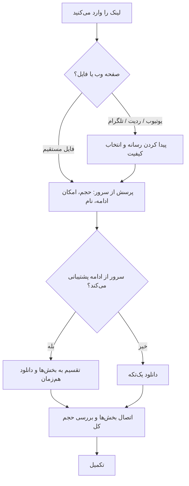

<div align="center">


**مدیر دانلود رایگان و متن‌باز برای اندروید، ویندوز، لینوکس، macOS و iOS**

[English](README.md) · [فارسی](README.fa.md) · [راهنمای توسعه‌دهندگان](docs/DEVELOPERS.md) · [نسخه‌ها](https://github.com/ghaderi0x/ZapDL/releases)

</div>

<div dir="rtl">

> **وضعیت: نسخه ۱٫۰٫۰.** تست‌های خودکار (۱۲۱ تست) موفق‌اند و نسخه ویندوز اجرا و استفاده شده است. نسخه‌های اندروید، لینوکس، macOS و iOS هنوز توسط نویسنده **بررسی نشده‌اند**. فهرست دقیق موارد بررسی‌شده و بررسی‌نشده در [`docs/CHECKLIST.md`](docs/CHECKLIST.md) است.

## ZapDL چه کار می‌کند؟

- **دانلود سریع:** فایل را به چند بخش تقسیم و هم‌زمان دانلود می‌کند (اگر سرور اجازه دهد) و با اطمینان کنار هم می‌گذارد.
- **توقف و ادامه:** هر وقت خواستید متوقف کنید، برنامه را ببندید و بعداً ادامه دهید. پیش از ادامه بررسی می‌شود که فایل روی سرور تغییر نکرده باشد.
- **لینک صفحه‌های وب:** لینک یوتیوب، ردیت، تلگرام یا صفحه معمولی را بدهید و کیفیت را انتخاب کنید.
- **گروه لینک‌ها:** چند لینک را یک‌جا اضافه کنید (مثلاً `game.part1.zip` و `game.part2.zip`). به ترتیب و یکی‌یکی دانلود می‌شوند و گزینه «دانلود خودکار بخش‌های بعدی» خودش part2، part3 … را پیدا می‌کند.
- **زمان‌بندی:** شروع دانلود در زمانی دیگر، یا فقط در ساعت‌های مشخص (مثلاً ۲۳ تا ۶ صبح).
- **فقط Wi-Fi:** هرگز از اینترنت موبایل استفاده نمی‌کند و با اتصال Wi-Fi خودش ادامه می‌دهد.
- **پروکسی، کوکی و هدر:** برای سایت‌هایی که پروکسی یا کوکی ورود می‌خواهند. رمزها در حافظه امن سیستم نگه‌داری می‌شوند.
- **دانلود در پس‌زمینه:** در اندروید با اعلان ادامه می‌دهد؛ در دسکتاپ می‌تواند در System Tray بماند.
- **اشتراک‌گذاری و رها کردن:** در اندروید لینک را از هر برنامه به ZapDL بفرستید؛ در دسکتاپ لینک یا فایل `.txt` را روی پنجره بکشید.
- **به‌روزرسانی از GitHub:** نسخه جدید را اعلام می‌کند، دانلود می‌کند، اثر انگشت SHA-256 را بررسی و نصب می‌کند. به‌روزرسانی از فایل هم ممکن است.
- **۶ زبان:** English، فارسی، العربية، Español، 中文، Русский. چیدمان راست‌به‌چپ برای فارسی و عربی خودکار است.
- **تم:** چهار تم (جنگل، غروب، اقیانوس، یخچال طبیعی) هرکدام با حالت خودکار، روشن و تیره، به‌علاوه رنگ دلخواه.

## نصب

فایل مناسب سیستم خود را از [صفحه نسخه‌ها](https://github.com/ghaderi0x/ZapDL/releases/latest) بگیرید:

| سیستم | فایل | روش نصب |
|---|---|---|
| اندروید | `ZapDL-<نسخه>-android.apk` | فایل را باز کنید و در صورت پرسش، «نصب از منابع ناشناس» را برای مرورگر یا مدیر فایل مجاز کنید. |
| ویندوز | `ZapDL-<نسخه>-windows-x64-setup.exe` (یا `.zip` قابل‌حمل) | نصب‌کننده را اجرا کنید. |
| لینوکس | `ZapDL-<نسخه>-linux-x64.tar.gz` | `tar -xzf ZapDL-*.tar.gz -C ~/zapdl && ~/zapdl/zapdl` |
| macOS | `ZapDL-<نسخه>-macos.dmg` | باز کنید و به Applications بکشید. برنامه هنوز notarize نشده؛ بار اول راست‌کلیک و Open. |
| iOS | هنوز منتشر نمی‌شود | حساب توسعه‌دهنده اپل لازم است؛ از سورس بسازید. |

بررسی سلامت فایل در لینوکس: `sha256sum -c SHA256SUMS.txt --ignore-missing`

نسخه‌های **مایکت** و **کافه‌بازار** (پس از انتشار) توسط خود فروشگاه به‌روز می‌شوند و به‌روزرسان داخلی در آن‌ها خاموش است.

## یک دانلود چگونه انجام می‌شود؟



دانلود فقط وقتی «تمام‌شده» نشان داده می‌شود که فایل کامل باشد و حجمش درست باشد.

## حریم خصوصی

- حساب کاربری، تبلیغ و آمارگیری ندارد و هیچ داده مصرفی‌ای نمی‌فرستد.
- فقط با سایت‌هایی که از آن‌ها دانلود می‌کنید، GitHub (برای بررسی به‌روزرسانی) و صفحه‌ای که لینک رسانه‌اش را می‌دهید ارتباط می‌گیرد.
- کوکی و رمز پروکسی در حافظه امن سیستم ذخیره می‌شوند.

## نکات مهم

- فقط چیزهایی را دانلود کنید که مجاز به دانلودشان هستید. ZapDL قفل DRM، پرداخت یا ورود را دور نمی‌زند.
- سایت‌های رسانه‌ای مدام تغییر می‌کنند و ممکن است بخش رسانه گاهی از کار بیفتد.
- فقط پروکسی HTTP پشتیبانی می‌شود؛ SOCKS و FTP/SFTP پشتیبانی نمی‌شوند. ZapDL از پروکسی سیستم ویندوز/macOS پیروی می‌کند. اگر یوتیوب در کشور شما فیلتر است، به پروکسی یا VPN سالم نیاز دارید (راهنما: [docs/MEDIA_SOURCES.md](docs/MEDIA_SOURCES.md)).
- اگر فایل دانلودشده را خارج از برنامه پاک کنید، ردیف آن «فایل حذف شده» نشان داده می‌شود و گزینه «دانلود دوباره» دارد.
- ترجمه‌ها ماشینی‌اند و نیاز به بازبینی دارند؛ اصلاحات شما ارزشمند است.

## ساخت از سورس

```bash
git clone https://github.com/ghaderi0x/ZapDL.git
cd ZapDL
dart tool/setup.dart
flutter test
flutter run -d linux
```

جزئیات بیشتر: [راهنمای توسعه‌دهندگان](docs/DEVELOPERS.md) و [راهنمای انتشار](docs/RELEASE.md).

## مجوز

[MIT](LICENSE)

</div>
