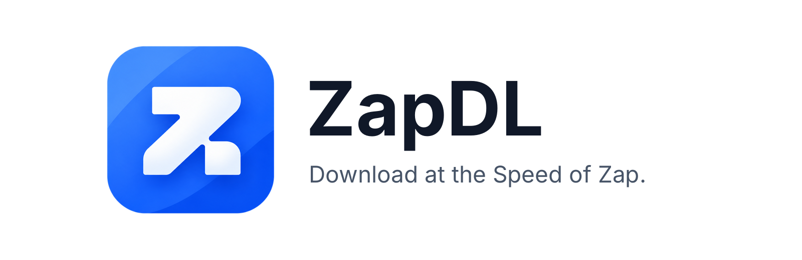
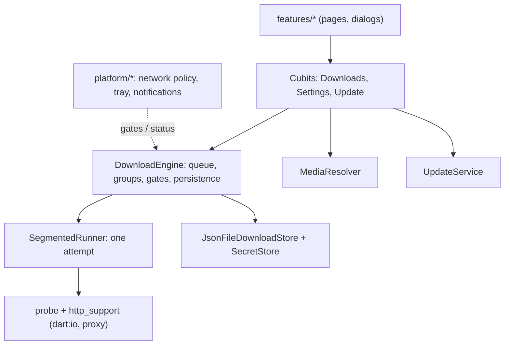

<div align="center">



### Fast, free download manager for Windows, Linux, macOS, Android and iOS

[](https://github.com/ghaderi0x/ZapDL/releases/latest)
[](https://github.com/ghaderi0x/ZapDL/actions/workflows/ci.yml)
[](LICENSE)


**[⬇ Download](#-download)** · **[Features](#-features)** · **[How to use](#-how-to-use)** · **[FAQ](#-faq)** · **[For developers](#-for-developers)** · [فارسی](README.fa.md)

<br>


</div>

---

## ⬇ Download

Get the file for your system from the **[latest release](https://github.com/ghaderi0x/ZapDL/releases/latest)**.

| Your system | File to download | Install |
|---|---|---|
| 🪟 **Windows** | `ZapDL-…-windows-x64-setup.exe` (or `…-windows-x64.zip`, no install) | Run it. No admin rights needed. |
| 🤖 **Android** | `ZapDL-…-android.apk` | Open the file and allow "install unknown apps" if asked. |
| 🐧 **Linux** | `ZapDL-…-linux-x64.tar.gz` | `tar -xzf ZapDL-*.tar.gz -C ~/zapdl && ~/zapdl/zapdl` |
| 🍎 **macOS** | `ZapDL-…-macos.dmg` | Drag to Applications. First launch: right-click → Open (not notarized yet). |
| 📱 **iOS** | not published | Needs an Apple developer account; build from source. |

Android users in Iran can also use **Myket** or **Cafe Bazaar** once ZapDL is listed there (store builds are updated by the store).

> **Status:** version 1.0.0. The automated tests pass and the Windows version has been used for real. Android, Linux and macOS builds are new and less tested; if something breaks, please [open an issue](https://github.com/ghaderi0x/ZapDL/issues/new/choose).

## ✨ Features

| | |
|---|---|
| ⚡ **Fast** | Splits files into parts and downloads them at the same time, when the server allows it. |
| ⏯ **Pause and resume** | Stop any time, close the app, continue later. If the file changed on the server, ZapDL tells you instead of corrupting it. |
| 📦 **Link groups** | Paste all parts of a game (`part1`, `part2`, …). They download one by one, in order. "Auto next part" finds `part2`, `part3` by itself. |
| 🎬 **Videos from links** | YouTube, Reddit, Telegram and normal web pages: paste the page link and choose a quality. |
| 🕒 **Schedule** | Start later, or only download between chosen hours (for example 23:00–06:00). |
| 📶 **Wi-Fi only** | Never uses mobile data; continues by itself when Wi-Fi is back. |
| 🌐 **Proxy, cookies, headers** | For filtered sites and sites that need a login cookie. Follows the Windows/macOS system proxy. |
| 🔔 **Status everywhere** | Progress in the Android notification, speed and count in the Windows tray. |
| 🗑 **Notices deleted files** | If you delete a finished file, the entry says "File deleted" and offers "Download again". |
| 🔄 **Self-update** | Checks GitHub Releases, downloads, verifies the SHA-256 fingerprint and installs. |
| 🎨 **4 themes × light/dark** | Forest, Sunset, Ocean, Glacier, plus a custom color and a one-tap dark/light button. |
| 🌍 **6 languages** | English, فارسی, العربية, Español, 中文, Русский, with automatic right-to-left layout. |
| 🔒 **Private** | No account, no ads, no analytics. |

## 🚀 How to use

1. **Add a link:** press **+** (or `Ctrl+N`), paste a link. ZapDL checks it and shows the name and size. On a computer you can also **drag links or a `.txt` file** onto the window; on Android use **Share → ZapDL** from any app.
2. **Choose** the folder and, for videos, the quality. Press **Add**.
3. **Watch** progress in the list. Tap an item for details; right-click (or the ⋮ menu) for pause, open, copy link, delete.

**Multi-part files:** in the add dialog press **Group of links**, paste one link per line in the right order, optionally turn on *Auto-download next parts*.

**YouTube is blocked where you live?** ZapDL can't unblock it by itself, but it works through your VPN/proxy. Leave *Settings → Network → Proxy* on **System** if your tool sets the system proxy, or choose **Manual** and enter its HTTP port (for example `127.0.0.1:10809`). SOCKS-only ports don't work. More in [docs/MEDIA_SOURCES.md](docs/MEDIA_SOURCES.md).

## ❓ FAQ

<details><summary><b>I opened ZapDL again and now there are two in Task Manager.</b></summary>
Fixed in 1.0.0: opening ZapDL again brings the running window to the front instead of starting a second copy.
</details>

<details><summary><b>"Waiting for an allowed connection"</b></summary>
You are offline, or "Wi-Fi only" is on while you are on mobile data. Connect to Wi-Fi or switch it off in Settings → Network.
</details>

<details><summary><b>Android says the update can't be installed.</b></summary>
Android only updates an app with a file signed by the same key. If your installed copy came from somewhere else (a self-built copy, for example), uninstall it and install the release APK.
</details>

<details><summary><b>Why no 1080p for YouTube?</b></summary>
YouTube serves high resolutions as separate video and audio files that must be merged with ffmpeg, which ZapDL doesn't include. You get ready-made files (usually up to 720p) or audio only.
</details>

<details><summary><b>Does it support FTP, torrents or SOCKS?</b></summary>
No. ZapDL does HTTP and HTTPS downloads, and HTTP proxies.
</details>

## 🔐 Privacy and fair use

- Nothing is sent anywhere except to the sites you download from, GitHub (update check) and the page whose media link you paste.
- Cookies and proxy passwords live in your system's secure storage, never in the download list, and are only sent to the site they were given for.
- ZapDL doesn't bypass DRM, paywalls or logins. Respect each site's terms and copyright law.
- Translations are machine-written and need native review; corrections are welcome.

---

# 🛠 For developers

Everything below is for people who want to run, change or release ZapDL.

## Stack

| Layer | Choice |
|---|---|
| UI | Flutter 3.27+ / Dart 3.6, Material 3 with a custom `ThemeExtension` (`ZapColors`) |
| State | `flutter_bloc` Cubits |
| DI | `get_it` (wired in `lib/core/di.dart`) |
| Download engine | **Pure Dart on `dart:io`** (no Flutter imports, testable without a device) |
| Storage | atomic JSON file for downloads; `shared_preferences` for settings; system secure storage for secrets |
| i18n | `gen-l10n` ARB files (6 languages), direction follows the app language |
| Native | small Kotlin foreground service on Android; tray + window management on desktop |
| Release | GitHub Actions builds, signs and publishes; the app updates itself from GitHub Releases |

## Run it

```bash
git clone https://github.com/ghaderi0x/ZapDL.git && cd ZapDL
dart tool/setup.dart        # flutter create + permissions + Kotlin service + icons + gen-l10n
flutter analyze
flutter test                # engine tests run against a local HTTP server
flutter run -d windows      # or linux / macos / an Android device
```

Linux needs `libayatana-appindicator3-dev libsecret-1-dev libnotify-dev` (and the usual Flutter Linux packages). `dart tool/setup.dart` is safe to re-run; it re-applies the platform patches.

## Project layout

```
lib/
  engine/      download engine (no Flutter): runner, probe, store, gates, parts, proxy
  features/    UI by feature: downloads, settings, stats, onboarding, shell
  media/       link → media resolver (YouTube, Reddit, Telegram, Open Graph, yt-dlp)
  platform/    notifications, tray, single instance, share intake, background service
  update/      GitHub Releases updater (semver, asset selection, SHA-256, installer)
  core/        DI, theme, formatting, app info (version, store flag)
  l10n/        ARB files
tool/          setup.dart, bump_version.dart, build_android.sh, Kotlin templates
test/          engine, update, platform, widget, theme tests
docs/          ARCHITECTURE, DEVELOPERS, RELEASE, GITHUB_GUIDE, MEDIA_SOURCES, CHECKLIST
```

## How it works



**One download attempt** (`lib/engine/runner.dart`): probe with `Range: bytes=0-0` → plan N contiguous segments → each segment streams to its own `partN` file (the real file length on disk is the source of truth after a crash) → on resume re-probe and compare ETag / Last-Modified / size → verify every part → merge to `<name>.zapdl-part` → check total size → atomic rename.

**Gates** (`EngineGate`): the engine only starts work when every gate is open: user not paused, network allowed (online and Wi-Fi-only respected), inside the schedule window. Platform code flips gates; the engine decides.

**Groups and parts:** tasks carry `groupId`/`groupOrder`; a task waits while an earlier one in its group is queued, running or paused. `autoNext` plus `parts.dart` probes `part N+1` when `part N` finishes and adds it to the group.

**Single instance:** `platform/single_instance.dart` holds a loopback port; a second launch asks the first to show its window and exits.

**Updater naming contract** (the workflow and `asset_selector.dart` must agree): `ZapDL-<v>-android.apk`, `-windows-x64-setup.exe`, `-windows-x64.zip`, `-linux-x64.tar.gz`, `-macos.dmg`, `SHA256SUMS.txt`. The `-android-store.apk` is never offered as an update.

More: [ARCHITECTURE](docs/ARCHITECTURE.md) · [DEVELOPERS](docs/DEVELOPERS.md) (engine internals, state diagram, how to add a language / site adapter / setting) · [MEDIA_SOURCES](docs/MEDIA_SOURCES.md).

## Release

```bash
dart tool/bump_version.dart 1.1.0     # pubspec + app_info + CHANGELOG
git commit -am "Release 1.1.0" && git tag v1.1.0 && git push origin main --tags
```

GitHub Actions then builds Android (signed), Windows (installer + zip), Linux, macOS, and publishes the Release with `SHA256SUMS.txt`. Android signing secrets and store notes: [docs/GITHUB_GUIDE.md](docs/GITHUB_GUIDE.md), [docs/RELEASE.md](docs/RELEASE.md). The Android build has two variants: the GitHub APK with the updater, and a store APK (`--dart-define=STORE_BUILD=true`) without it.

## Contributing

Bug reports, translations and pull requests are welcome: see [CONTRIBUTING.md](CONTRIBUTING.md). Security issues: [SECURITY.md](SECURITY.md). What is verified and what isn't: [docs/CHECKLIST.md](docs/CHECKLIST.md).

## License

[MIT](LICENSE). Bundled fonts (Vazirmatn, Inter, Noto Sans SC) are under the SIL Open Font License, see `assets/fonts/LICENSES.txt`.
