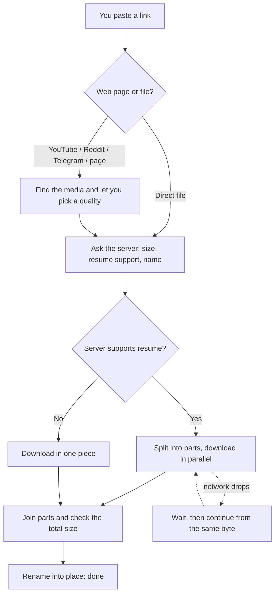
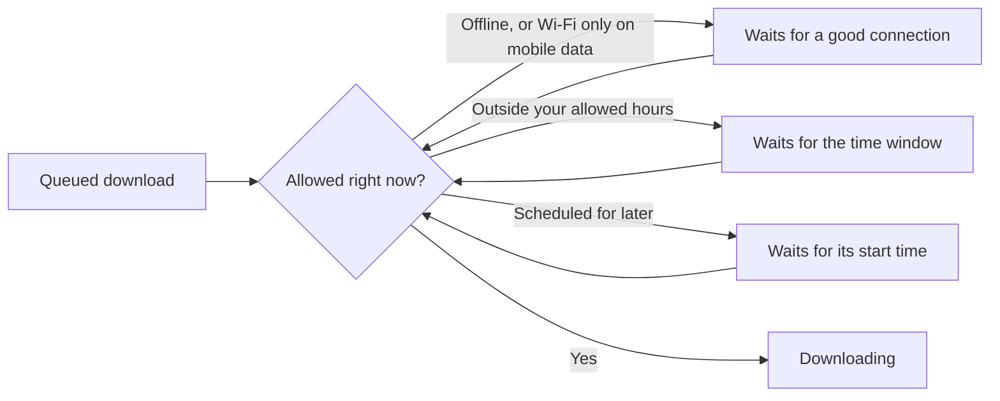
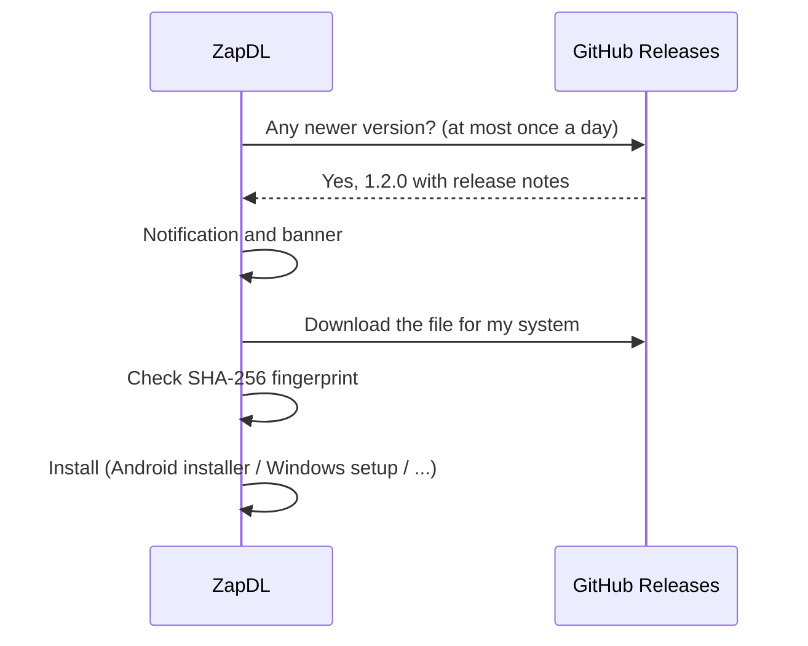

<div align="center">


**A free, open-source download manager for Android, Windows, Linux, macOS and iOS.**

[](https://github.com/ghaderi0x/ZapDL/releases)
[](https://github.com/ghaderi0x/ZapDL/actions/workflows/ci.yml)
[](LICENSE)


[English](README.md) · [فارسی](README.fa.md) · [Developer guide](docs/DEVELOPERS.md) · [Releases](https://github.com/ghaderi0x/ZapDL/releases)

</div>

> **Status: v1.0.0.** The automated tests pass (121) and the Windows build has been run and used. Android, Linux, macOS and iOS builds have **not** been verified by the author yet, so expect rough edges there. [`docs/CHECKLIST.md`](docs/CHECKLIST.md) lists exactly what is and isn't verified.

---

## What ZapDL does

| | |
|---|---|
| **Fast downloads** | Splits a file into parts and downloads them in parallel (when the server allows it), then joins them safely. |
| **Pause and resume** | Stop any time, close the app, come back later. ZapDL checks the file hasn't changed on the server before continuing. |
| **Links from web pages** | Paste a YouTube, Reddit, Telegram or ordinary web page link and choose the quality. |
| **Link groups** | Add several links at once (for example `game.part1.zip`, `game.part2.zip`). They download one after another in order, and "auto-download next parts" finds part2, part3… by itself. |
| **Schedule** | Start a download later, or only download between certain hours (for example 23:00 to 06:00). |
| **Wi-Fi only** | Never use mobile data. Downloads wait for Wi-Fi and continue by themselves. |
| **Proxy, cookies, headers** | For sites that need a proxy, a login cookie or a Referer. Passwords are kept in your system's secure storage. |
| **Background downloads** | Android keeps going with a notification; desktop can live in the tray. |
| **Share and drop** | Share a link from any Android app to ZapDL, or drag links / `.txt` / `.url` files onto the desktop window. |
| **Updates from GitHub** | Tells you when a new version is out, downloads it, checks its fingerprint (SHA-256) and installs it. You can also update from a file. |
| **6 languages** | English, فارسی, العربية, Español, 中文, Русский. Right-to-left layout is automatic for Persian and Arabic. |
| **Themes** | Four themes (Forest, Sunset, Ocean, Glacier), each in Auto, Light or Dark, plus a custom accent color. |

## Install

Download the file for your system from the [**Releases page**](https://github.com/ghaderi0x/ZapDL/releases/latest):

| System | File | How to install |
|---|---|---|
| **Android** | `ZapDL-<version>-android.apk` | Open the file. If Android asks, allow "install unknown apps" for your browser or file manager. |
| **Windows** | `ZapDL-<version>-windows-x64-setup.exe` (or the `.zip` for a portable copy) | Run the installer. No administrator rights needed. |
| **Linux** | `ZapDL-<version>-linux-x64.tar.gz` | `tar -xzf ZapDL-*.tar.gz -C ~/zapdl && ~/zapdl/zapdl` |
| **macOS** | `ZapDL-<version>-macos.dmg` | Open it and drag ZapDL to Applications. The app is not notarized yet, so right-click → Open the first time. |
| **iOS** | not distributed yet | Needs an Apple developer account; build from source. |

> Every release has a `SHA256SUMS.txt`. To check a download on Linux: `sha256sum -c SHA256SUMS.txt --ignore-missing`.

Android users can also get the app from **Myket** or **Cafe Bazaar** once it is listed there. Those builds are updated by the store, so the in-app updater is switched off in them.

## How a download works



ZapDL only marks a download as finished after the file is complete and its size matches. A broken or partial download is never shown as done.

## When do downloads run?



| Platform | While the app is closed to the background |
|---|---|
| Android | Keeps downloading; a notification shows progress. (Some phone makers kill background apps. Turn off battery optimization for ZapDL if that happens.) |
| Windows / Linux / macOS | Keeps downloading while the app is open. With "Keep running in the tray" on, closing the window hides it instead of quitting. |
| iOS | iOS freezes apps in the background, so downloads pause and **resume automatically** when you come back. |

## Updates



You can turn automatic checks off, skip a version, include beta versions, or install from a file you downloaded yourself (Settings → Updates).

## Privacy

- ZapDL has **no accounts, no ads and no analytics**. It does not send usage data anywhere.
- It only contacts the sites you download from, GitHub (to check for updates), and the page you ask it to look at when you paste a media link.
- Cookies and proxy passwords are stored in your system's secure storage (Keychain, Android Keystore, Windows DPAPI, libsecret) and are never written to the download list.
- Credentials are only sent to the site you gave them for, not to another site after a redirect.

## Good to know

- **Use it for things you may download.** ZapDL does not bypass DRM, paywalls or logins. Follow each website's terms and copyright law.
- **Media sites change often.** YouTube, Reddit and others can break the media features at any time; updating ZapDL fixes that. For YouTube you get ready-made video+audio files (often up to 720p) or audio only. Higher qualities need ffmpeg, which ZapDL does not include.
- **Proxy:** HTTP proxies only; SOCKS is not supported. ZapDL follows the Windows/macOS system proxy. If YouTube is filtered where you live, you need a working proxy or VPN; see [docs/MEDIA_SOURCES.md](docs/MEDIA_SOURCES.md).
- **Deleted files:** if you delete a finished file outside ZapDL, the entry is marked "File deleted" and offers "Download again".
- **FTP/SFTP** is not supported.
- Translations are machine-written and need review by native speakers. Corrections are very welcome.

## FAQ

<details><summary>Why does my download say "Waiting for an allowed connection"?</summary>
Either you are offline, or "Wi-Fi only" is on and you are on mobile data. Connect to Wi-Fi or switch the option off in Settings → Network.
</details>

<details><summary>Android says the update can't be installed.</summary>
Android only updates an app with a file signed by the same developer key. If you installed ZapDL from a different source (for example a self-built copy), uninstall it first, then install the release APK.
</details>

<details><summary>Why is there no 1080p for YouTube?</summary>
YouTube serves high resolutions as separate video and audio files that must be joined with ffmpeg. ZapDL does not bundle ffmpeg, so it offers the ready-made files only.
</details>

<details><summary>Does it work with a VPN or proxy?</summary>
A VPN works like any other connection. For a proxy, use Settings → Network → Proxy (HTTP proxies).
</details>

## Build from source

You need [Flutter](https://docs.flutter.dev/get-started/install) 3.27 or newer.

```bash
git clone https://github.com/ghaderi0x/ZapDL.git
cd ZapDL
dart tool/setup.dart     # creates the platform folders, icons, permissions
flutter test
flutter run -d linux     # or windows / macos / an Android device
```

More in the [developer guide](docs/DEVELOPERS.md) and [release guide](docs/RELEASE.md).

## Contributing

Bug reports, translation fixes and pull requests are welcome. Read [CONTRIBUTING.md](CONTRIBUTING.md) first. Security problems: see [SECURITY.md](SECURITY.md).

## License

[MIT](LICENSE). Bundled fonts (Vazirmatn, Inter, Noto Sans SC) are under the SIL Open Font License; see `assets/fonts/LICENSES.txt`.
