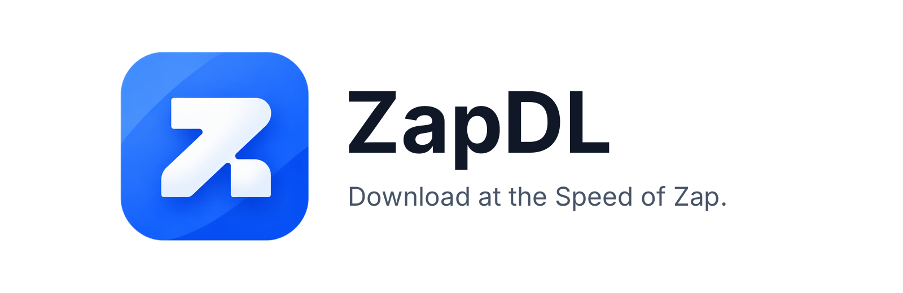

## Download anything, fast. Free, private, no ads.

ZapDL is a download manager for **Windows, Linux, macOS and Android**.
It makes big downloads faster, lets you pause and continue them, and saves videos and music from popular sites.

**[⬇ Download](#-download)** · **[What it does](#-what-it-does)** · **[How to use](#-how-to-use)** · **[Questions](#-questions)** · [فارسی](README.fa.md)

 

---

## ⬇ Download

Open the **[Releases page](https://github.com/ghaderi0x/ZapDL/releases/latest)** and pick the file for your device.

| Your device | Download | How to install |
|---|---|---|
| 🪟 **Windows** | `ZapDL-…-windows-x64-setup.exe` | Double-click it. No administrator rights needed. Prefer no installer? Use the `.zip` and run `zapdl.exe`. |
| 🤖 **Android** | `ZapDL-…-android.apk` | Open the file. If Android asks, allow "install unknown apps" for your browser or file manager. |
| 🐧 **Linux** (Ubuntu, Debian, Mint) | `ZapDL-…-linux-amd64.deb` | `sudo apt install ./ZapDL-*-linux-amd64.deb` |
| 🐧 **Linux** (other) | `ZapDL-…-linux-x64.tar.gz` | Extract it anywhere and run the `zapdl` file inside. |
| 🍎 **macOS** | `ZapDL-…-macos.dmg` | Drag ZapDL to Applications. The first time, right-click it and choose **Open**. |

> **Good to know**
> - ZapDL is new (version 1.0). Windows is the most tested; Android, Linux and macOS are less tested, so please [report problems](https://github.com/ghaderi0x/ZapDL/issues/new/choose).
> - Windows or macOS may warn that the app is from an "unknown publisher". The app isn't code-signed yet; the warning is expected.
> - Spotify isn't supported (its music is encrypted). Sites blocked in your country may need the *filter* option or a VPN; see [Questions](#-questions).

## ✨ What it does

**Download faster**
- Splits a file into parts and downloads them at the same time, when the server allows it.
- **Pause and resume** any time, even after closing the app. If the file changed on the server, ZapDL tells you instead of saving a broken file.

**Save from your favorite sites**
- Paste a link from **YouTube, TikTok, Instagram, X (Twitter), Telegram, Reddit or SoundCloud** and choose a quality.
- Works with normal links to any file, too.

**Multi-part files**
- Paste all the parts of a game (`part1`, `part2`, …) as a **group**. They download one by one, in order.
- Turn on **auto next part** and ZapDL finds `part2`, `part3`… by itself.

**Stay organized**
- Everything goes to `Downloads/ZapFiles`, sorted into Videos, Music, Images, Documents, Archives and Programs.
- Click a file's name to open it. If you delete a file, the list says so and offers *Download again*.

**Download when you want**
- **Schedule** downloads for the night, or only between chosen hours.
- **Wi-Fi only** mode protects your mobile data.
- See progress in the Android notification, or speed and count in the Windows tray.

**Made for you**
- 4 color themes (Forest, Sunset, Ocean, Glacier), each with light and dark mode.
- 6 languages with right-to-left support: English, فارسی, العربية, Español, 中文, Русский.
- Updates itself from GitHub.
- Private: no account, no ads, no tracking.

## 🚀 How to use

1. **Add a link.** Press **+** (or `Ctrl+N`) and paste it. ZapDL shows the name and size. On a computer you can also drag links, or a `.txt` file of links, onto the window. On Android, use **Share → ZapDL** from any app.
2. **Choose** where to save it and, for videos, the quality. Press **Add**.
3. **Watch it download.** Tap an item to see details. Right-click it (or use the ⋮ menu) to pause, open, copy the link or delete it.

**Several parts of one file?** In the add window press **Group of links**, put one link on each line in order, and optionally turn on *Auto-download next parts*.

## ❓ Questions

<b>Instagram, YouTube or Telegram are blocked in my country. What can I do?</b>

Try these in order:

1. **Settings → Reach filtered sites without a VPN.** It uses encrypted DNS and splits the start of each secure connection, which gets past some filters. It is experimental, it isn't a VPN, and it doesn't work on every internet provider. It can't help when a site is blocked by its IP address, which is common for Telegram.
2. **Use your own VPN or proxy.** If your VPN sets the system proxy, leave *Settings → Network → Proxy* on **System**. Otherwise choose **Manual** and enter its HTTP port (for example `127.0.0.1:10809`). SOCKS-only ports don't work.

<b>Why isn't Spotify supported?</b>

Spotify's audio is encrypted, so no honest downloader can save it. SoundCloud and YouTube work.

<b>Why can't I choose 1080p on YouTube?</b>

YouTube serves high resolutions as separate video and sound files that need a tool called ffmpeg to join. ZapDL doesn't include it, so you get ready-made files (usually up to 720p) or audio only. On a computer, installing <a href="https://github.com/yt-dlp/yt-dlp">yt-dlp</a> makes ZapDL use it first, which often gives more options.

<b>It says "Waiting for an allowed connection".</b>

You're offline, or <i>Wi-Fi only</i> is on while you use mobile data. Connect to Wi-Fi, or turn it off in Settings → Network.

<b>Android says the update can't be installed.</b>

Android only updates an app with a file signed by the same key. If your copy came from somewhere else, uninstall it once and install the APK from the Releases page.

<b>Does it support torrents, FTP or SOCKS proxies?</b>

No. ZapDL downloads over HTTP and HTTPS and works with HTTP proxies.

<b>Is it safe? What does it send?</b>

It contacts only the sites you download from, GitHub (to check for updates), and the page of a media link you paste. Cookies and proxy passwords are kept in your system's secure storage. There is no account, advertising or analytics. ZapDL doesn't bypass paywalls, logins or encryption. Please follow each site's rules and your country's copyright law.

## 💬 Help and feedback

- Found a bug or have an idea? [Open an issue](https://github.com/ghaderi0x/ZapDL/issues/new/choose).
- Want to fix a translation? Translations were machine-written, so corrections from native speakers are very welcome.
- Want to build it yourself or help with the code? See the **[developer guide](docs/DEVELOPERS.md)**.

## License

[MIT](LICENSE): free to use, change and share. Bundled fonts (Vazirmatn, Inter, Noto Sans SC) use the SIL Open Font License; see `assets/fonts/LICENSES.txt`.
