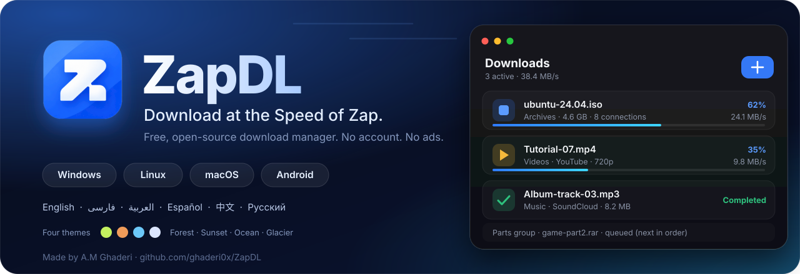
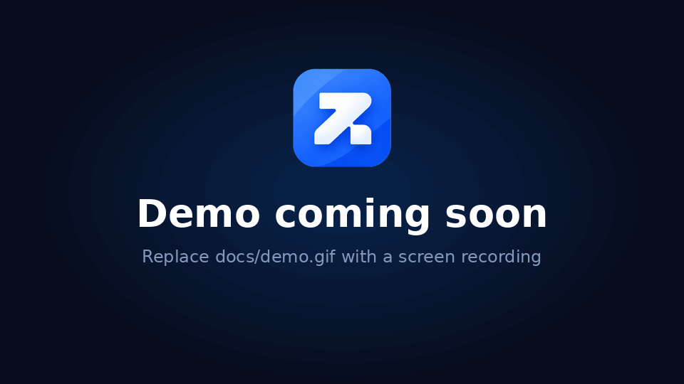

<p align="center">
  
</p>

<p align="center">
  <a href="https://github.com/ghaderi0x/ZapDL/releases/latest"></a>
  <a href="https://github.com/ghaderi0x/ZapDL/stargazers"></a>
  <a href="LICENSE"></a>
  
</p>

<p align="center">
  <a href="https://github.com/ghaderi0x/ZapDL/releases/latest"></a>
  &nbsp;
  <a href="https://github.com/ghaderi0x/ZapDL/issues/new/choose"></a>
</p>

<p align="center">
  <b>English</b> · <a href="README.fa.md">فارسی</a>
  &nbsp;|&nbsp;
  <a href="#-download">Download</a> ·
  <a href="#-features">Features</a> ·
  <a href="#-get-started">Get started</a> ·
  <a href="#-faq">FAQ</a> ·
  <a href="#-build-from-source">Build</a> ·
  <a href="docs/DEVELOPERS.md">Developer guide</a> ·
  <a href="CHANGELOG.md">Changelog</a>
</p>

<p align="center">
  
  <br>
  <sub>A closer look at downloading with ZapDL.</sub>
</p>

---

## Meet your new download manager

Downloading should be easy. Whether you are saving a document, grabbing a large file or keeping a video for later, **ZapDL** brings your downloads together in one clean app: free, open source, with no account and no ads.

|  |  |
|:--|:--|
| ⚡ **Faster downloads**<br>Files are fetched in several parts at once, whenever the server allows it. | ⏯️ **Pause and resume**<br>Stop now, continue later, even after you close and reopen ZapDL. |
| 🎬 **Save online media**<br>Paste a link from a supported site and pick from the available qualities. | 🗂️ **Stay organised**<br>Downloads are sorted into clear categories, in one folder. |
| 🌍 **Six languages**<br>English, فارسی, العربية, Español, 中文 and Русский, with right-to-left layout. | 🔐 **Private by design**<br>No account, no ads, no tracking, no analytics. |

## ✨ Features

### ⚡ Downloads that keep moving
- Multi-connection downloads when the server supports them.
- Pause and resume at any time.
- Interrupted downloads continue after you restart the app.
- Detects that a remote file has changed before resuming, instead of saving a damaged file.

### 🌍 Your favourite content, within reach
Paste links from supported services:

<p align="center">
  <b>YouTube</b> &nbsp;·&nbsp; <b>TikTok</b> &nbsp;·&nbsp; <b>Instagram</b> &nbsp;·&nbsp; <b>X / Twitter</b> &nbsp;·&nbsp; <b>Telegram</b> &nbsp;·&nbsp; <b>Reddit</b> &nbsp;·&nbsp; <b>SoundCloud</b>
</p>

Regular files work too: any HTTP or HTTPS link.

<sub>Supported links and available qualities depend on the source site. Not every link or media item can be downloaded. Spotify is not supported because its audio is encrypted.</sub>

### 🧩 Multi-part downloads, made simple
Large games and archives often come in several parts. Add the part links as one **group** and ZapDL downloads them one after another, in order. Turn on **Auto-download next parts** and it looks for the next numbered part by itself.

### 🗂️ A place for every download
Everything goes into `Downloads/ZapFiles`, sorted into:

<p align="center">
  <code>Videos</code> · <code>Music</code> · <code>Images</code> · <code>Documents</code> · <code>Archives</code> · <code>Programs</code>
</p>

Click a finished file's name to open it. If you delete a file from disk, ZapDL marks it as deleted and lets you download it again.

### 🕒 Your time, your rules
- **Schedule** downloads for a time that suits you, or limit them to selected hours.
- **Wi-Fi only** protects your mobile data.
- Follow progress in Android notifications or the Windows system tray.

### 🎨 A look that feels like yours
<p align="center">
  
  
  
  
</p>

- Four themes, each with light and dark appearances, or pick your own accent colour.
- Six languages, with right-to-left layout for Persian and Arabic.
- Adapts to phone, tablet and desktop.

### 🔐 Private by design
- No account. No ads. No tracking or analytics.
- Cookies and proxy passwords are kept in your system's secure storage.
- Open source under the MIT licence.

ZapDL connects only to the sites involved in your downloads and to GitHub for update checks. See the [FAQ](#-faq).

---

## 📦 Download

Get the latest build from **[GitHub Releases](https://github.com/ghaderi0x/ZapDL/releases/latest)**.

| Platform | File | How to install |
|:--|:--|:--|
| 🪟 **Windows** | `ZapDL-…-windows-x64-setup.exe` | Run the installer. No administrator rights needed. For a portable copy, extract the `.zip` and run `zapdl.exe`. |
| 🤖 **Android** | `ZapDL-…-android.apk` | Open the APK. If asked, allow your browser or file manager to install unknown apps. |
| 🐧 **Debian / Ubuntu / Mint** | `ZapDL-…-linux-amd64.deb` | `sudo apt install ./ZapDL-*-linux-amd64.deb` |
| 🐧 **Other Linux** | `ZapDL-…-linux-x64.tar.gz` | Extract it and run the `zapdl` executable. |
| 🍎 **macOS** | `ZapDL-…-macos.dmg` | Open the DMG and drag ZapDL into Applications. On first launch, right-click and choose **Open**. |

<details>
<summary><b>Important notes</b></summary>

- ZapDL is a new project (version 1.0). Windows is the most tested platform; Android, Linux and macOS have had less testing. Please [report any issue](https://github.com/ghaderi0x/ZapDL/issues/new/choose).
- ZapDL is not code-signed yet, so Windows or macOS may warn about an unknown publisher. This is expected.
- ZapDL checks GitHub for new versions and can update itself. You can verify a download against `SHA256SUMS.txt` on the release page.
</details>

---

## 🚀 Get started

**1. Add a download.** Press **+** (or <kbd>Ctrl</kbd>+<kbd>N</kbd>, <kbd>Cmd</kbd>+<kbd>N</kbd> on macOS) and paste a link. On desktop you can also drag a URL, or a `.txt` file full of links, into the window. On Android, use **Share → ZapDL** from any app.

**2. Choose your options.** Pick the destination folder and, for media, your preferred quality.

**3. Press Add.** Watch the progress in your downloads list.

**4. Manage it.** Select a download to see its details. Use the right-click menu or the **⋮** menu to pause, open, copy the link or delete it.

<details>
<summary><b>How do I download a multi-part file?</b></summary>

1. Open the add-download window.
2. Choose **Group of links**.
3. Paste one link per line, in the right order.
4. Optionally turn on **Auto-download next parts**.

ZapDL downloads each part in turn.
</details>

---

## ❓ FAQ

<details>
<summary><b>A website is blocked in my country. What can I do?</b></summary>

1. **Settings → Reach filtered sites without a VPN.** This experimental option uses encrypted DNS and splits the start of secure connections. It may work with some filters, but it is not a VPN and does not work with every provider. It cannot help with IP-based blocking, which is common for Telegram.
2. **Use your own VPN or proxy.** If your VPN sets the system proxy, leave **Settings → Network → Proxy** on **System**. Otherwise choose **Manual** and enter your HTTP proxy port (for example `127.0.0.1:10809`). SOCKS-only ports are not supported.
</details>

<details>
<summary><b>Can I download music from Spotify?</b></summary>

No. Spotify audio is encrypted, so ZapDL cannot download it. SoundCloud and YouTube are supported where the source makes the media available.
</details>

<details>
<summary><b>Why can't I choose 1080p on YouTube?</b></summary>

YouTube may offer high-resolution video and audio as separate files that must be combined with a tool such as FFmpeg. ZapDL does not bundle FFmpeg, so ready-made downloads are usually available up to 720p, or as audio only. On desktop, installing [yt-dlp](https://github.com/yt-dlp/yt-dlp) lets ZapDL use it first and may offer more formats.
</details>

<details>
<summary><b>Why does it say "Waiting for an allowed connection"?</b></summary>

Your device may be offline, or **Wi-Fi only** may be on while you use mobile data. Connect to Wi-Fi or turn off **Settings → Network → Wi-Fi only**.
</details>

<details>
<summary><b>Android says the update cannot be installed.</b></summary>

Android only updates an app with a package signed by the same key. If your installed copy came from another source, uninstall it once and install the APK from the official [Releases page](https://github.com/ghaderi0x/ZapDL/releases/latest).
</details>

<details>
<summary><b>Does ZapDL support torrents, FTP or SOCKS proxies?</b></summary>

Not currently. ZapDL supports HTTP and HTTPS downloads and HTTP proxies.
</details>

<details>
<summary><b>Is ZapDL safe? What does it send?</b></summary>

ZapDL needs no account and has no ads or analytics. It connects to:

- the sites you choose to download from;
- GitHub, to check for updates;
- the page of a media link you paste, when needed to find the available media.

Cookies and proxy passwords are kept in your system's secure storage. ZapDL does not bypass paywalls, logins or encryption. Please follow the rules of the sites you use and the copyright laws of your country.
</details>

---

## 🛠 Build from source

You need the [Flutter SDK](https://docs.flutter.dev/get-started/install) (3.27 or newer).

```bash
git clone https://github.com/ghaderi0x/ZapDL.git
cd ZapDL

dart tool/setup.dart        # creates and patches the platform folders, gets packages, generates translations
flutter analyze
flutter test
flutter run -d windows      # or: linux, macos, or an Android device
```

Linux needs a few system packages and Android needs a signing key for release builds: see [`docs/PLATFORM_NOTES.md`](docs/PLATFORM_NOTES.md) and [`docs/RELEASE.md`](docs/RELEASE.md).

**Releasing:** `dart tool/bump_version.dart X.Y.Z`, commit, tag `vX.Y.Z` and push. The release workflow builds the Windows installer and zip, the Linux `.deb` and `.tar.gz` and the macOS `.dmg`, then publishes them with `SHA256SUMS.txt`. Keep the file names as they are, because the in-app updater picks files by name.

## 🧱 Project layout

```
lib/
  engine/      download engine: probe, segments, resume, queue, store (pure Dart)
  media/       link resolver and site adapters (YouTube, TikTok, Instagram, X, ...)
  platform/    notifications, tray, share intake, background service, network policy
  update/      GitHub release check, asset choice, installer launch
  features/    downloads, settings, onboarding, stats, shell
  core/        theme, fonts, DI, helpers
  l10n/        English, Persian, Arabic, Spanish, Chinese and Russian strings
test/          engine, media, update, platform and widget tests
installer/     Windows installer script
tool/          setup, version bump, Android templates
docs/          architecture, design spec, developer guide, release notes
```

## 📚 Documentation

[Developer guide](docs/DEVELOPERS.md) · [Architecture](docs/ARCHITECTURE.md) · [Design spec](docs/DESIGN_SPEC.md) · [Media sources](docs/MEDIA_SOURCES.md) · [Platform notes](docs/PLATFORM_NOTES.md) · [Release guide](docs/RELEASE.md) · [Checklist](docs/CHECKLIST.md) · [Changelog](CHANGELOG.md)

## ⚠️ Known limits

- No torrents, FTP or SOCKS-only proxies.
- No DRM bypass, so Spotify and other encrypted audio are out of scope.
- Without FFmpeg, YouTube downloads are usually limited to 720p or audio only.
- Media sites change often, so a source can stop working until ZapDL is updated.
- Windows and macOS builds are not code-signed yet.

## 🤝 Contributing

Bug reports, ideas, translations and code are welcome.

| I want to… | Go to |
|:--|:--|
| Report a bug | [Open an issue](https://github.com/ghaderi0x/ZapDL/issues/new/choose) |
| Suggest a feature | [Open an issue](https://github.com/ghaderi0x/ZapDL/issues) |
| Improve a translation | Edit the files in `lib/l10n/` and open a pull request |
| Contribute code | Read [`CONTRIBUTING.md`](CONTRIBUTING.md) and the [developer guide](docs/DEVELOPERS.md) |

## 📄 Licence

ZapDL is released under the [MIT Licence](LICENSE). The bundled fonts (Vazirmatn, Inter and Noto Sans SC) are under the SIL Open Font License; see `assets/fonts/LICENSES.txt`.

<p align="center">
  <a href="https://github.com/ghaderi0x/ZapDL"></a>
  <br><br>
  <sub>Made by <a href="https://github.com/ghaderi0x"><b>A.M Ghaderi</b></a> · ZapDL: your downloads, under control.</sub>
</p>
