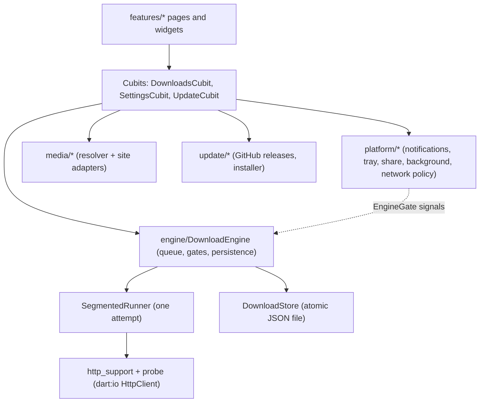
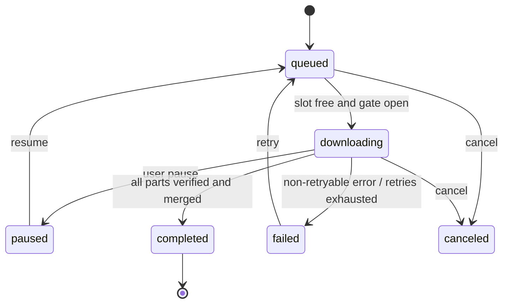
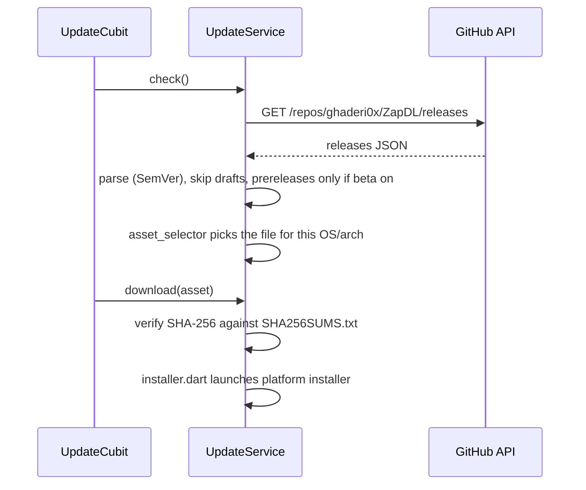

# Developer guide

How ZapDL is built and why. For the short layer table see [ARCHITECTURE.md](ARCHITECTURE.md); for what is verified see [CHECKLIST.md](CHECKLIST.md).

> **Honesty note:** this code was written without a Flutter SDK. It has been statically checked (bracket balance, imports, ARB key parity) but **never compiled or run**. Treat the first `flutter analyze` / `flutter test` as the real test and expect fixes.

## Stack

Flutter 3.27+ / Dart 3.6, `flutter_bloc` (Cubits) for UI state, `get_it` for dependency injection, `gen-l10n` ARB files for translations, `ThemeExtension` for the design tokens. The download engine is **pure Dart on `dart:io`** with no Flutter imports, so it is testable without a device and could run in a background isolate.

## Layers

## The engine (`lib/engine`)

### Download life cycle

`DownloadStatus` is `queued | downloading | paused | completed | failed | canceled`. Errors are `DownloadErrorCode` values; the engine never holds user-facing text, the UI maps codes to localized strings.

### One attempt (`SegmentedRunner`)

1. **Probe** (`probe.dart`): `GET` with `Range: bytes=0-0`. A `206` means ranges work and `Content-Range` gives the total; `200` means no ranges. Name comes from `Content-Disposition`, else the URL.
2. **Plan** (`planSegments`): if ranges work and the size is known, split into `min(connections, total ~/ minSegmentBytes)` contiguous ranges; otherwise exactly one segment. Ranges are never combined when the server cannot serve them.
3. **Download:** each segment streams into its own `partN` file. **The real part-file length on disk is the source of truth** (`_syncFromDisk`), so a crash can never skip or duplicate bytes.
4. **Resume validation:** before continuing, probe again and compare ETag / Last-Modified / size. A change raises `changed` (restart needed); a server that stops honoring ranges raises `rangeIgnored`.
5. **Finalize:** every part must have exactly its length; merge into `<final>.zapdl-part`, check total size, atomically rename. The final path is checked to stay inside the download directory.
6. Memory stays bounded: data is flushed about every 1 MiB. Speed limiting is a simple elapsed-time throttle.

If one segment fails, sibling segments are aborted and the first error is rethrown.

### Gates (`EngineGate`)

The engine runs queued work only when every gate is open: `open`, `suspended` (user paused all), `network` (offline or Wi-Fi-only on mobile data) and `schedule` (outside the allowed daily window or before a task's start time). Platform code (`network_policy.dart`) only flips gates; the engine decides.

### Groups, parts and missing files

- `DownloadTask.groupId/groupOrder`: `_pump` skips a queued task while an earlier one in its group is queued, downloading or paused (`_groupReady`). Failed/canceled earlier tasks do not block.
- `autoNext` + `parts.dart` (`nextPartUrl`): when a task completes, the engine probes the next part's URL and adds it to the same group; a 404 ends the chain.
- `fileMissing` is a transient flag set by `refreshMissingFiles()` (on init, every ~10 ticks, and when the app regains focus) for completed tasks whose file no longer exists.
- `system_proxy.dart` reads the OS proxy (Windows registry, macOS `scutil`) because dart:io only honors environment variables.

### Persistence

`DownloadStore` is an interface. `JsonFileDownloadStore` writes atomically (temp file + rename). `InMemoryDownloadStore` is the test double. Secrets (cookies, auth headers, proxy password) go to `SecretStore` (system secure storage, `secure_secret_store.dart`) and are **not** in the JSON file. Auth headers are only sent to the original host.

## State and DI

`core/di.dart` wires everything with `get_it` at startup (engine, store, settings, updater, platform services). Cubits are provided by `app.dart`. `_autoCheckForUpdates` is skipped when `isStoreBuild`.

## Theme, fonts, languages

- `core/theme`: colors as a `ThemeExtension` (`ZapColors`), accent palette, per-language font choice (`app_fonts.dart`).
- Fonts: Vazirmatn for fa/ar, Inter for en/es/ru, a Noto Sans SC **subset** for zh (the subset covers the characters used in the ARB; re-subset when you add Chinese text).
- **Direction follows the language**, not the OS locale: fa and ar are RTL, the rest LTR.
- Add a language: copy `lib/l10n/app_en.arb` to `app_xx.arb`, translate, register the locale in the settings language list and add a font mapping if needed. All ARBs must keep the same keys and placeholders (a check script is described in CONTRIBUTING).

## Platform services (`lib/platform`)

| Service | Android | Desktop | iOS |
|---|---|---|---|
| Background | Kotlin foreground service (`tool/templates/android`) via MethodChannel `dev.zapdl/background` | tray + keep running | none (OS suspends; downloads resume) |
| Share intake | `ACTION_SEND text/plain` intent | drag and drop | not implemented |
| Notifications | local notifications | local notifications | local notifications |

`tool/setup.dart` patches the generated platform folders (permissions, service, intent filter, entitlements, Info.plist) and installs the Kotlin templates, because those folders are generated by `flutter create` and not stored in the repo template.

## Media (`lib/media`)

`resolver.dart` picks an adapter by URL; adapters in `adapters.dart` call each site's public endpoints and return `MediaItem`s with direct URLs that then go through the normal engine. These break whenever sites change; see [MEDIA_SOURCES.md](MEDIA_SOURCES.md). No DRM bypass, no ffmpeg bundling (so no merged high-resolution YouTube).

## Updater (`lib/update`)

**Naming contract** (`asset_selector.dart` and the release workflow must agree): `ZapDL-<v>-android.apk`, `-windows-x64-setup.exe`, `-windows-x64.zip`, `-linux-x64.tar.gz`, `-macos.dmg`, `SHA256SUMS.txt`. `-android-store.apk` is never offered as an update. Tags containing `-` are prereleases.

## Two Android builds

`--dart-define=STORE_BUILD=true` sets `isStoreBuild` (hides updater UI, skips auto-check) and `tool/build_android.sh` strips `REQUEST_INSTALL_PACKAGES` from that build's manifest. Both are signed with the same key.

## Testing

`test/` covers the engine against a local `HttpServer` (ranges, resume, changed file, failures), probe parsing, file utils, semver/asset selection, store, and `app_info` (pubspec version equals `appVersion`). UI and platform channels have **no** automated tests yet. Run `flutter test`.

## Conventions

- No user-facing strings in code: use ARB keys.
- Engine code must not import Flutter.
- No feature is advertised in the README unless it is implemented; list gaps in CHECKLIST.md.
- Releases: `dart tool/bump_version.dart X.Y.Z`, commit, tag `vX.Y.Z`, push (see [GITHUB_GUIDE.md](GITHUB_GUIDE.md)).

## Adding things

- **Setting:** field in `SettingsCubit` state + persistence + UI tile + ARB keys in all six files.
- **Site adapter:** implement the adapter interface in `media/adapters.dart`, register it in `resolver.dart`, add a test with a recorded sample response.
- **Error code:** add to `DownloadErrorCode`, map in `errors.dart`, handle the UI switch (it is exhaustive), add ARB strings.
